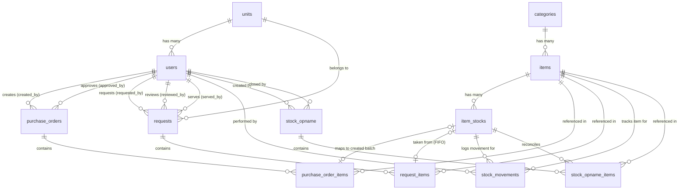

# Struktur Database Aplikasi Sarpras (Sarana & Prasarana) RS

Dokumen ini mendokumentasikan struktur database, relasi antarentitas, dan logika bisnis inventori (termasuk FIFO dan Stock Movement) pada aplikasi **Sarpras RS**.

---

## 1. Diagram Relasi Entitas (ERD)

Berikut adalah diagram visual yang menunjukkan hubungan antar tabel dalam database aplikasi Sarpras:

---

## 2. Kamus Data & Detail Tabel

### A. Pengguna & Unit Organisasi

#### 1. `units`
Mewakili instalasi, bangsal, poli, atau departemen di lingkungan rumah sakit (misal: IGD, ICU, Rawat Inap, Keuangan).
* **`id`**: Primary Key (BigInt, Auto Increment)
* **`name`**: Nama unit (e.g., "Instalasi Gawat Darurat")
* **`code`**: Kode unik unit (e.g., "IGD")
* **`description`**: Keterangan tambahan (Nullable)
* **`is_active`**: Status aktif unit (Boolean, default: `true`)
* **`deleted_at`**: Pendukung Soft Delete

#### 2. `users`
Akun pengguna yang terhubung ke unit tertentu dan memiliki peran akses khusus.
* **`id`**: Primary Key
* **`name`**: Nama lengkap pengguna
* **`email`**: Email unik (untuk login)
* **`password`**: Hash password
* **`employee_id`**: NIP / ID Karyawan (Unique, Nullable)
* **`phone`**: Nomor HP / telepon (Nullable)
* **`role`**: Hak akses pengguna (`admin`, `sarpras`, `unit` - default: `unit`)
* **`unit_id`**: FK ke `units.id` (set null on delete) — Menentukan unit kerja user.
* **`is_active`**: Status keaktifan (Boolean, default: `true`)

---

### B. Katalog & Manajemen Stok Utama

#### 3. `categories`
Kategori klasifikasi barang.
* **`id`**: Primary Key
* **`name`**: Nama kategori (e.g., "Alat Tulis Kantor", "Alat Kesehatan")
* **`code`**: Kode unik kategori (e.g., "ATK", "ALKES")
* **`item_type`**: Tipe barang (`consumable` / BHP, `inventory` / Aset)
* **`description`**: Keterangan kategori
* **`is_active`**: Status aktif

#### 4. `items`
Katalog master barang sarana dan prasarana.
* **`id`**: Primary Key
* **`category_id`**: FK ke `categories.id` (restrict on delete)
* **`name`**: Nama barang (e.g., "Kertas A4 80gr", "Masker Medis")
* **`code`**: Kode unik barang (e.g., "BRG-ATK-0001")
* **`unit_of_measure`**: Satuan terkecil barang (e.g., "pcs", "box", "roll")
* **`item_type`**: Jenis barang (`consumable`, `inventory`)
* **`image_path`**: Lokasi file gambar barang (Nullable)
* **`is_active`**: Status aktif barang

#### 5. `item_stocks`
Tabel penampung **batch stok** di Gudang Utama. Menggunakan pendekatan per-batch agar mendukung pencatatan harga beli yang fluktuatif serta pelacakan tanggal kadaluarsa (Expired Date) secara akurat.
* **`id`**: Primary Key
* **`item_id`**: FK ke `items.id` (restrict on delete)
* **`purchase_price`**: Harga beli per satuan pada batch ini (Decimal 15,2)
* **`selling_price`**: Harga keluar/transfer internal untuk unit (Decimal 15,2)
* **`quantity`**: Sisa stok riil yang tersedia pada batch spesifik ini (Integer)
* **`minimum_stock`**: Batas minimum stok batch untuk memicu notifikasi reorder
* **`batch_number`**: Nomor batch / lot produksi dari supplier (Nullable)
* **`expired_date`**: Tanggal kadaluarsa barang (Nullable)
* **`notes`**: Catatan tambahan mengenai batch ini
* **Indeks Khusus**:
  * `['item_id', 'created_at']` & `['item_id', 'quantity']` untuk optimasi pencarian **FIFO** dan stok tersedia.

---

### C. Pengadaan (Procurement)

#### 6. `purchase_orders`
Mencatat dokumen pemesanan barang ke supplier luar untuk menambah persediaan.
* **`id`**: Primary Key
* **`po_number`**: Nomor PO otomatis unik (e.g., `PO-2026-0001`)
* **`created_by`**: FK ke `users.id` (petugas pembaca/pembuat PO)
* **`approved_by`**: FK ke `users.id` (petugas sarpras/pimpinan pembuka persetujuan)
* **`supplier_name`**: Nama pemasok
* **`supplier_contact`**: Kontak/Telepon pemasok
* **`status`**: Status PO (`draft`, `approved`, `ordered`, `received`, `cancelled`)
* **`order_date`**: Tanggal pemesanan
* **`expected_date`**: Estimasi tanggal penerimaan
* **`received_date`**: Tanggal aktual penerimaan barang
* **`total_amount`**: Nilai total transaksi PO
* **`notes`**: Catatan pengadaan

#### 7. `purchase_order_items`
Rincian barang yang dipesan dalam satu dokumen PO.
* **`id`**: Primary Key
* **`purchase_order_id`**: FK ke `purchase_orders.id` (cascade on delete)
* **`item_id`**: FK ke `items.id` (restrict on delete)
* **`item_stock_id`**: FK ke `item_stocks.id` (nullable, set null on delete). Terisi otomatis setelah barang fisik diterima untuk menautkan PO ke batch stok baru yang terbentuk.
* **`quantity_ordered`**: Jumlah unit yang dipesan
* **`quantity_received`**: Jumlah unit aktual yang diterima (bisa berbeda jika ada selisih pengiriman)
* **`unit_price`**: Harga beli per unit
* **`subtotal`**: Total harga item (Stored Generated Column: `quantity_ordered * unit_price`)
* **`batch_number`**: Nomor batch dari supplier untuk batch stok
* **`expired_date`**: Tanggal kadaluarsa untuk batch stok
* **`notes`**: Catatan per item

---

### D. Permintaan Barang Internal (Request)

#### 8. `requests`
Mencatat dokumen pengajuan permintaan barang habis pakai atau aset dari unit kerja rumah sakit ke bagian Sarpras.
* **`id`**: Primary Key
* **`request_number`**: Nomor permintaan unik (e.g., `REQ-2026-0001`)
* **`requested_by`**: FK ke `users.id` (User unit yang mengajukan)
* **`unit_id`**: FK ke `units.id` (Unit asal pengaju)
* **`status`**: Status permintaan:
  * `pending`: Diajukan pertama kali, menunggu verifikasi
  * `approved`: Disetujui sarpras, menunggu disiapkan/diambil
  * `partial`: Disetujui sebagian karena keterbatasan stok gudang
  * `rejected`: Ditolak oleh Sarpras
  * `ready`: Barang sudah disiapkan oleh Sarpras, menunggu diambil unit
  * `completed`: Barang sudah diambil oleh unit
  * `cancelled`: Dibatalkan oleh pengaju
* **`priority`**: Tingkat urgensi (`low`, `normal`, `high`, `urgent`)
* **`request_date`**: Tanggal pengajuan dokumen
* **`needed_date`**: Tanggal batas barang harus sudah ada
* **`purpose`**: Keperluan / tujuan penggunaan (misal: "Untuk operasional IGD bulan Juni")
* **`notes`**: Catatan tambahan pengaju
* **`reviewed_by`**: FK ke `users.id` (Petugas Sarpras yang memverifikasi)
* **`reviewed_at`**: Waktu verifikasi
* **`review_notes`**: Catatan penolakan / persetujuan dari Sarpras
* **`served_by`**: FK ke `users.id` (Petugas Sarpras yang menyiapkan barang di gudang)
* **`served_at`**: Waktu barang selesai disiapkan
* **`received_by_name`**: Nama perwakilan unit yang mengambil barang fisik ke gudang
* **`received_at`**: Waktu penyerahan barang selesai dilakukan

#### 9. `request_items`
Rincian item barang yang diminta dalam satu dokumen Permintaan.
* **`id`**: Primary Key
* **`request_id`**: FK ke `requests.id` (cascade on delete)
* **`item_id`**: FK ke `items.id` (restrict on delete)
* **`item_stock_id`**: FK ke `item_stocks.id` (nullable, set null on delete). Diisi oleh petugas Sarpras saat barang disiapkan, merujuk ke batch stok spesifik yang dikurangi (pelacakan FIFO).
* **`quantity_requested`**: Jumlah barang yang diajukan oleh unit
* **`quantity_approved`**: Jumlah barang yang disetujui Sarpras (bisa lebih kecil dari permintaan jika stok terbatas)
* **`quantity_given`**: Jumlah aktual barang yang diserahkan ke unit
* **`status`**: Status item (`pending`, `approved`, `partial`, `rejected`)
* **`rejection_reason`**: Alasan jika item tersebut ditolak
* **`notes`**: Catatan per item

---

### E. Riwayat Transaksi & Audit Stok (Stock Ledger)

#### 10. `stock_movements`
Buku besar (*ledger*) mutasi stok. Setiap kali stok bertambah atau berkurang, wajib mencatat baris di tabel ini untuk kepentingan audit dan transparansi histori kartu stok.
* **`id`**: Primary Key
* **`item_stock_id`**: FK ke `item_stocks.id` (restrict on delete)
* **`item_id`**: FK ke `items.id` (restrict on delete)
* **`movement_type`**: Jenis pergerakan barang (`in`, `out`, `adjustment`, `return`)
  * `in`: Barang masuk dari pemesanan/pengadaan (PO)
  * `out`: Barang keluar didistribusikan ke unit (Request)
  * `adjustment`: Koreksi dari Stock Opname fisik
  * `return`: Pengembalian barang berlebih dari unit ke gudang sarpras
* **`quantity`**: Jumlah kuantitas mutasi (Positif untuk penambahan, Negatif untuk pengurangan)
* **`stock_before`**: Jumlah stok batch sebelum transaksi dilakukan
* **`stock_after`**: Jumlah stok batch sesudah transaksi dilakukan
* **`reference_type`**: Nama Class Model referensi (Polymorphic Manual, misal: `App\Models\PurchaseOrder`, `App\Models\Request`, atau `App\Models\StockOpname`)
* **`reference_id`**: ID dari record model referensi terkait
* **`performed_by`**: FK ke `users.id` (Petugas pelaksana mutasi)
* **`notes`**: Deskripsi detail (misal: "Penerimaan dari PO-2026-0005")

---

### F. Stock Opname (Rekonsiliasi Stok)

#### 11. `stock_opname`
Mencatat dokumen kegiatan stocktaking berkala untuk menyesuaikan catatan sistem dengan kondisi fisik gudang.
* **`id`**: Primary Key
* **`opname_number`**: Nomor dokumen opname unik (e.g., `OPN-2026-05`)
* **`created_by`**: FK ke `users.id` (Petugas yang memulai opname)
* **`closed_by`**: FK ke `users.id` (Petugas Gudang/Sarpras yang menutup & menyetujui hasil opname)
* **`status`**: Status aktivitas (`open`, `in_progress`, `closed`)
* **`opname_date`**: Tanggal pelaksanaan opname
* **`closed_date`**: Tanggal penyelesaian opname
* **`notes`**: Catatan umum opname

#### 12. `stock_opname_items`
Rincian perhitungan fisik item stok per-batch selama stock opname berlangsung.
* **`id`**: Primary Key
* **`stock_opname_id`**: FK ke `stock_opname.id` (cascade on delete)
* **`item_stock_id`**: FK ke `item_stocks.id` (restrict on delete) - Batch spesifik yang sedang dihitung
* **`item_id`**: FK ke `items.id` (restrict on delete)
* **`system_quantity`**: Jumlah stok tercatat di sistem saat opname dimulai
* **`physical_quantity`**: Jumlah stok aktual hasil perhitungan fisik di gudang (Nullable)
* **`difference`**: Selisih kuantitas (`physical_quantity - system_quantity`, negatif berarti barang hilang/kurang)
* **`is_adjusted`**: Status apakah selisih ini sudah dimasukkan ke tabel `stock_movements` sebagai penyesuaian (Boolean, default: `false`)
* **`notes`**: Catatan per-item opname (misal: "Kemasan rusak", "Barang tercecer")
* **Kombinasi Unik**: `['stock_opname_id', 'item_stock_id']` menjamin satu batch stok hanya dihitung sekali dalam satu dokumen opname.

---

## 3. Logika Alur Bisnis Database Utama (StockService)

Seluruh perubahan mutasi stok yang terjadi di database dikelola secara terpusat oleh class `App\Services\StockService` dalam bentuk **Database Transaction** demi menjamin keutuhan data (*Data Integrity*). Berikut 3 alur utama:

### 1. Alur Pengadaan Barang Masuk (PO Received)
Ketika status `PurchaseOrder` diubah menjadi `received` (Diterima):
1. Sistem mengiterasi seluruh `purchase_order_items`.
2. Untuk setiap item, dibuat baris baru di tabel `item_stocks` (Batch Stok baru) dengan data harga unit PO, jumlah kuantitas yang diterima, nomor batch, dan tanggal kedaluwarsa.
3. Menghubungkan ID batch baru tersebut ke kolom `item_stock_id` di `purchase_order_items`.
4. Mencatat riwayat mutasi di tabel `stock_movements` dengan tipe `in` dan kuantitas positif.
5. Memperbarui status dokumen `purchase_orders` menjadi `received`.

### 2. Alur Pengeluaran Barang FIFO (Request Fulfill)
Ketika Sarpras menyetujui dan menyiapkan barang untuk Unit (status `Request` menjadi `ready`):
1. Mengambil item-item dari `request_items`.
2. Untuk setiap item, sistem mencari batch stok aktif di `item_stocks` yang berelasi dengan `item_id` tersebut di mana `quantity > 0`, diurutkan secara **FIFO** (`orderBy('created_at', 'asc')`).
3. Mengurangi kolom `quantity` pada baris `item_stocks` yang tertua secara bertahap sampai kebutuhan terpenuhi.
4. Setiap pengurangan batch stok dicatat ke `stock_movements` dengan tipe `out` dan kuantitas negatif (menyimpan nilai `stock_before` dan `stock_after`).
5. Menyimpan tautan batch stok utama yang dikurangi pada kolom `item_stock_id` di `request_items`, beserta kuantitas riil yang berhasil diberikan (`quantity_given`).
6. Memperbarui status dokumen `requests` menjadi `ready`.

### 3. Alur Stock Opname (Adjustment)
Ketika dokumen `StockOpname` ditutup (`closed`):
1. Sistem mencari semua item opname (`stock_opname_items`) yang belum disesuaikan (`is_adjusted = false`).
2. Jika ada selisih kuantitas (`difference !== 0`):
   * Mengupdate kuantitas (`quantity`) di baris `item_stocks` menjadi nilai perhitungan fisik (`physical_quantity`).
   * Membuat rekaman mutasi stok baru di `stock_movements` dengan tipe `adjustment` dan nilai selisihnya (positif/negatif).
3. Mengubah tanda `is_adjusted = true` pada item terkait.
4. Memperbarui status dokumen `stock_opname` menjadi `closed`.
